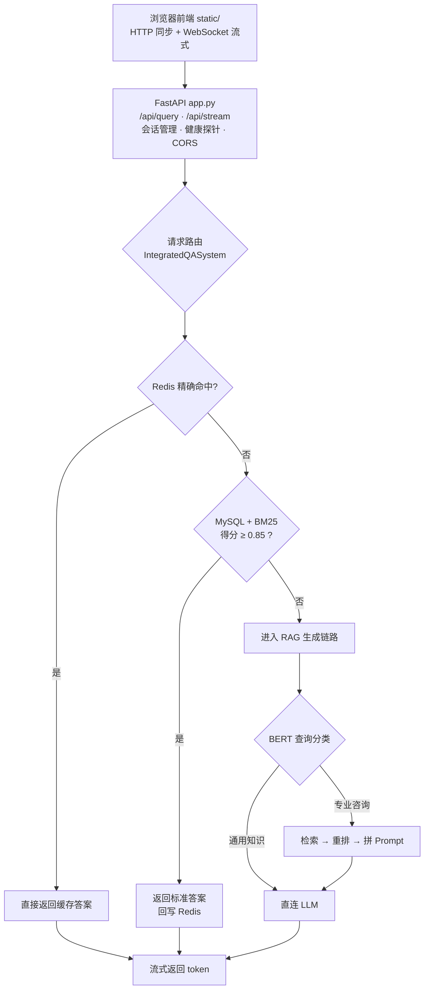
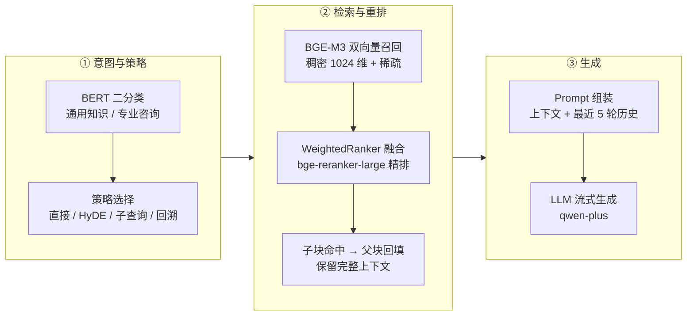

# EduRAG · 集成 MySQL / Redis / Milvus 的教育领域智能问答系统

> 一个"能直接跑起来、能讲清楚为什么这么设计"的 RAG 工程化项目：
> **BM25 精确命中兜底 + BERT 意图分流 + 四种检索策略 + 混合检索重排 + 流式输出**。


---

## 1. 项目简介

面向 IT 教育/招生咨询场景，用户的问题是**长尾且高度重复**的："人工智能学科 V6.0 学费多少？"、"教学点在哪？"、"这个项目和别人比有什么优势？"。

如果每句话都直连大模型，会有三个问题：**贵**（每次调用都烧 token）、**慢**（首字延迟高）、**不准**（模型会编造学费和课程信息）。

本项目围绕这三个问题做工程化设计：

| 问题 | 解法 |
| --- | --- |
| 贵 | Redis 缓存 + MySQL 标准问答库命中，**约 85% 的高频问题不消耗 LLM token** |
| 慢 | 多级路由尽早返回；LLM 侧用 WebSocket 逐 token 推流，首字延迟从"整段生成完"降到"第一个 token" |
| 不准 | BERT 二分类判断"要不要查知识库"；专业问题走 RAG，检索结果经 CrossEncoder 重排后再喂给 LLM，答案可溯源 |

---

## 2. 功能特性

- **多级问答路由**：Redis 精确命中 → MySQL + BM25 相似度命中（阈值 0.85）→ RAG 生成 → 兜底话术，四级降级链路，任何一级失败都不会把错误抛给用户。
- **BERT 查询分类器**：微调 `bert-base-chinese` 做二分类（通用知识 / 专业咨询）。通用问题直连 LLM 省一次检索，专业问题才走向量库，**用小模型挡掉大部分检索开销**。
- **四种检索策略**：直接检索 / HyDE 假设文档检索 / 子查询拆分检索 / 回溯问题检索，由 LLM 按问题形态自动选择，覆盖"明确查询"到"抽象开放问题"。
- **混合检索 + 重排**：BGE-M3 同时产出稠密向量（1024 维）与稀疏向量，Milvus 内做 `IVF_FLAT + SPARSE_INVERTED_INDEX` 双路召回，`WeightedRanker` 融合后用 `bge-reranker-large` 精排。
- **父子块（Parent-Child）切分**：子块负责"召回准"，父块负责"上下文全"，命中子块后回溯父块送进 Prompt。
- **多格式文档入库**：PDF / Word / PPT / 图片（OCR）统一走 Loader → 中文语义切分 → 向量化 → Milvus。
- **流式 Web 服务**：FastAPI + WebSocket 逐 token 推送，带 `start / token / end / error` 帧协议；HTTP 侧保留同步查询接口。
- **会话记忆**：MySQL `conversation` 表按 `session_id` 保存最近 5 轮对话，超出自动裁剪，避免上下文膨胀。
- **可观测与可评估**：统一日志（请求、路由结果、检索耗时、LLM 耗时）；RAGAS 评估脚本从**忠实度 / 答案相关性 / 上下文精确率 / 上下文召回率**四个维度量化效果。

---

## 3. 系统架构

### 3.1 请求路由总览



### 3.2 RAG 内部流水线



### 3.3 一次请求的完整链路

1. **前端**：`POST /api/query` 先做一次轻量判断；需要流式时改走 `ws://.../api/stream`。
2. **FastAPI 层**：解析请求、生成/复用 `session_id`、过滤问候语（正则直出，不浪费任何检索）。
3. **BM25 路由**：先查 Redis 是否有完全相同的问题；没有则在 MySQL 全量问题上算 BM25 分数，softmax 归一化后取 Top1。
   - `score ≥ 0.85`：直接返回标准答案，并回写 Redis。
   - 否则：标记 `need_rag`，进入 RAG。
4. **RAG 链路**：拉取最近 5 轮历史 → BERT 分类 → 选策略 → 混合检索 + 重排 → 拼 Prompt → LLM 流式生成。
5. **收尾**：更新 `conversation` 表、记录各阶段耗时到日志、按 `token/end` 帧推给前端。

### 3.4 为什么这样设计（面试可讲的三个取舍）

- **为什么用 BM25 而不是直接全量走向量检索？**
  教育问答里大量问题是"原题复现"，BM25 对关键词命中的判别又快又准，且完全不消耗模型算力。把"标准答案"和"需要推理生成"分开，是成本与效果的最优分界。
- **为什么用 BERT 小模型做分流，而不是让 LLM 自己判断？**
  分类是二分类任务，BERT 微调后单次推理毫秒级、零 token 成本，适合高 QPS 前置过滤；LLM 判断需要额外一次调用且不稳定。**用小模型做门控、大模型做生成**是工业界常见组合。
- **为什么检索要做父子块 + 重排？**
  块太小语义不完整，块太大向量被稀释。子块召回、父块回填兼顾"找得准"与"答得全"；CrossEncoder 重排弥补双塔向量"粗排"的精度损失。

---

## 4. 目录结构

```
mysql_system/
├── app.py                        # FastAPI 入口：HTTP + WebSocket + 静态资源
├── new_main.py                   # 集成问答系统（当前主链路，带会话历史与流式）
├── main.py                       # 早期版本（仅命令行，保留做对比）
├── config.ini.example            # 配置模板（复制为 config.ini 后填真实值）
├── requirements.txt              # 完整依赖快照（由 pip freeze 导出）
├── requirements-core.txt         # 核心依赖（适合快速搭环境）
├── base/
│   ├── config.py                 # 配置解析（环境变量优先，其次 config.ini）
│   └── logger.py                 # 统一日志
├── mysql_qa/
│   ├── db/mysql_client.py        # MySQL 连接、jpkb 表、问答读写
│   ├── cache/redis_client.py     # Redis 缓存（问题答案 + BM25 语料缓存）
│   ├── retrieval/BM25_search.py  # BM25 召回 + 阈值路由
│   └── utils/preprocess.py       # 中文分词 / 文本预处理
├── rag_qa/
│   ├── core/
│   │   ├── vector_store.py       # Milvus 集合、双向量入库、混合检索 + 重排
│   │   ├── new_rag_system.py     # RAG 主流程（分类 → 策略 → 检索 → 生成）
│   │   ├── query_classifier.py   # BERT 二分类（含训练 / 评估 / 推理）
│   │   ├── strategy_selector.py  # 四种检索策略的 LLM 选择器
│   │   ├── document_processor.py # 文档解析与父子块切分
│   │   └── prompt.py             # 各阶段 Prompt 模板
│   ├── edu_document_loaders/     # PDF / Word / PPT / 图片(OCR) 加载器
│   ├── edu_text_spliter/         # 中文语义切分器
│   ├── classify_data/            # 分类器训练数据（5000 条）
│   └── rag_assessment/           # RAGAS 评估脚本与评估集
├── static/                       # 前端页面（原生 HTML/JS）
└── logs/                         # 运行日志（不入库）
```

---

## 5. 技术栈

| 层次 | 选型 |
| --- | --- |
| Web 服务 | FastAPI、Uvicorn、WebSocket、Pydantic |
| 结构化存储 | MySQL（PyMySQL）：标准问答库 `jpkb`、会话历史 `conversation` |
| 缓存 / 召回加速 | Redis：问题级答案缓存、BM25 语料缓存 |
| 向量检索 | Milvus 2.4（pymilvus）：稠密 + 稀疏混合检索 |
| 嵌入 / 重排 | BGE-M3（稠密 1024 维 + 稀疏）、bge-reranker-large（CrossEncoder） |
| 意图识别 | 微调 `bert-base-chinese`（BertForSequenceClassification） |
| 生成模型 | Qwen-Plus（DashScope OpenAI 兼容接口，可替换） |
| 文档处理 | pdfplumber / python-docx / python-pptx / OCR、LangChain 中文切分 |
| 评估 | RAGAS（faithfulness / answer_relevancy / context_precision / context_recall） |
| 工程化 | 日志分级、配置外置、密钥环境变量化、`.gitignore` 防泄漏 |

---

## 6. 快速开始

### 6.1 环境要求

- Python **3.10**（3.9~3.11 亦可）
- 外部服务：**MySQL 5.7+**、**Redis 6+**、**Milvus 2.4+**（可用 Docker 起单机版）
- 硬件：模型总计约 **6.3 GB**，建议 ≥ 8 GB 显存的 GPU；纯 CPU 能跑但首响明显变慢
- 大模型：任意 OpenAI 兼容接口（默认 DashScope `qwen-plus`，需自备 API Key）

### 6.2 安装

```bash
git clone <your-repo-url>
cd mysql_system

python -m venv .venv
# Windows
.venv\Scripts\activate
# Linux / macOS
source .venv/bin/activate

pip install -r requirements-core.txt
```

> `requirements.txt` 是完整环境快照（含大量间接依赖与平台相关包），换机器时优先用 `requirements-core.txt`。

### 6.3 配置

```bash
cp config.ini.example config.ini    # Windows: copy config.ini.example config.ini
```

填写 `config.ini` 中的 MySQL / Redis / Milvus 连接信息与 `dashscope_api_key`。
密钥也可以不改文件、直接用环境变量覆盖（**优先级更高**）：

```bash
# Windows PowerShell
$env:DASHSCOPE_API_KEY="sk-xxxxxxxx"
# Linux / macOS
export DASHSCOPE_API_KEY="sk-xxxxxxxx"
```

### 6.4 准备模型

将以下模型放到 `rag_qa/models/`（目录结构需一致；模型体积大，不随仓库分发）：

```
rag_qa/models/
├── bert-base-chinese/                          # BERT 底座（约 1.2 GB）
├── bert_query_classifier/                      # 微调后的二分类模型（约 390 MB）
├── bge-m3/                                     # 嵌入模型（约 2.2 GB）
├── bge-reranker-large/                         # 重排模型（约 2.1 GB）
└── nlp_bert_document-segmentation_chinese-base/# 语义切分（约 390 MB）
```

未训练分类器时，`QueryClassifier` 会**自动回退**到 `bert-base-chinese` 底座初始化（可用但分类效果未调优）。

### 6.5 初始化数据库

```sql
-- 标准问答表（由 mysql_client.create_table() 自动建，也可手动执行）
CREATE TABLE IF NOT EXISTS jpkb (
  id INT AUTO_INCREMENT PRIMARY KEY,
  question TEXT NOT NULL,
  answer TEXT NOT NULL,
  source VARCHAR(50)
);

-- 会话历史表（必须手动建，代码中未自动创建）
CREATE TABLE IF NOT EXISTS conversation (
  id INT AUTO_INCREMENT PRIMARY KEY,
  session_id VARCHAR(64) NOT NULL,
  question TEXT,
  answer TEXT,
  timestamp DATETIME DEFAULT CURRENT_TIMESTAMP,
  INDEX idx_session (session_id)
);
```

导入问答数据：`mysql_qa/data/JP学科知识问答.csv`（该 CSV 属于课程资料，仓库中未包含，可替换为自己的问答数据）。

### 6.6 构建向量库

```bash
# 将 rag_qa/data/ai_data 下的文档解析、切分、向量化写入 Milvus
python rag_qa/core/vector_store.py
```

### 6.7 启动

```bash
python app.py
# 或
uvicorn app:app --host 0.0.0.0 --port 8080
```

打开 `http://127.0.0.1:8080/`，接口文档 `http://127.0.0.1:8080/docs`。

---

## 7. 接口说明

| 方法 | 路径 | 说明 |
| --- | --- | --- |
| `GET` | `/` | 前端页面 |
| `GET` | `/health` | 健康检查（K8s 就绪/存活探针） |
| `GET` | `/api/sources` | 可用学科类别列表 |
| `POST` | `/api/create_session` | 创建会话，返回 `session_id` |
| `POST` | `/api/query` | 同步问答（可命中缓存/标准库时直接返回） |
| `WS` | `/api/stream` | 流式问答（逐 token 推送） |
| `GET` | `/api/history/{session_id}` | 查询会话历史 |
| `DELETE` | `/api/history/{session_id}` | 清空会话历史 |

**同步查询**

```bash
curl -X POST http://127.0.0.1:8080/api/query \
  -H "Content-Type: application/json" \
  -d '{"query":"人工智能学科学费是多少","source_filter":"ai","session_id":"demo-1"}'
```

```json
{
  "answer": "...",
  "is_streaming": false,
  "session_id": "demo-1",
  "processing_time": 0.83
}
```

`is_streaming: true` 表示该问题需要 RAG 流式生成，前端应改用 WebSocket。

**WebSocket 帧协议**（`ws://127.0.0.1:8080/api/stream`）

```jsonc
// 客户端 → 服务端
{"query": "AI 课程项目是独立完成还是小组合作？", "source_filter": "ai", "session_id": "demo-1"}

// 服务端 → 客户端
{"type": "start", "session_id": "demo-1"}
{"type": "token", "token": "人工", "session_id": "demo-1"}
{"type": "end",   "is_complete": true, "processing_time": 2.31, "session_id": "demo-1"}
{"type": "error", "error": "..."}
```

---

## 8. 关键配置项

| 配置 | 默认 | 说明 |
| --- | --- | --- |
| `retrieval.parent_chunk_size` | 512 | 父块长度：送入 LLM 的上下文粒度 |
| `retrieval.child_chunk_size` | 256 | 子块长度：参与向量匹配的粒度 |
| `retrieval.chunk_overlap` | 50 | 相邻块重叠，防止语义被切断 |
| `retrieval.retrieval_k` | 5 | 向量召回数量 |
| `retrieval.candidate_m` | 20 | 重排后进入 Prompt 的候选数 |
| BM25 阈值 | 0.85 | 低于该值判定"标准库没有可靠答案"，转 RAG |
| `llm.model` | qwen-plus | 生成模型，可换任意兼容接口 |
| `app.valid_sources` | 视数据而定 | 学科白名单，非法值自动忽略 |

---

## 9. 评估

### 9.1 检索 / 生成质量（RAGAS）

```bash
python rag_qa/rag_assessment/rag_as.py
```

对 `rag_evaluate_data.json`（30 条带标准答案的评测集）计算：

- `faithfulness`：答案是否忠实于检索到的上下文（衡量幻觉）
- `answer_relevancy`：答案与问题的语义相关度
- `context_precision`：检索结果中有效内容的比例
- `context_recall`：标准答案所需信息被检索到的比例

### 9.2 意图分类器

`query_classifier.py` 内置训练与评估流程（3 epoch、AdamW、warmup、按 `eval_loss` 保存最优）：

```bash
python rag_qa/core/query_classifier.py
```

评估输出 `classification_report` 与混淆矩阵，可用它定位"该检索却没检索 / 不该检索却检索"的样本。

> 建议：把你自己环境跑出的真实指标填到本节，比只写"效果良好"有说服力得多。

---

## 10. 工程化细节

- **密钥零硬编码**：`base/config.py` 中 API Key 只从 `os.environ` 或 `config.ini` 读取，源码不含真实 Key；`config.ini` 已被 `.gitignore` 排除。
- **大文件不入库**：模型权重（6.3 GB）、数据集、日志、缓存、IDE 配置全部 ignore，仓库只保留可读代码。
- **配置外置**：数据库、模型、检索参数均可通过 `config.ini` 调整，不改代码即可换环境。
- **统一日志**：`logs/app.log` 记录请求内容、路由决策、各阶段耗时，便于排查"慢在哪一步"。
- **优雅降级**：LLM 超时/异常返回兜底话术与客服电话，不会让前端白屏。

---

## 11. 已知限制与后续优化

- **BM25 软阈值**：softmax 归一化后最高分与语料规模相关，跨数据集需要重新校准 `0.85`。
- **单例单进程**：`IntegratedQASystem` 全局实例化，多 worker 部署时需改为按需初始化或共享连接池。
- **检索策略串行**：子查询检索为串行遍历，可改为并发召回后合并。
- **可加缓存层**：把"query → 检索结果"做语义缓存（向量相似度命中），进一步降低 RAG 延迟。
- **可加重排兜底**：重排模型不可用时自动退回融合排序，目前未实现。
- **前端**：`static/index.html` 为原生实现，可迁移到 React + 组件化（同目录 `static/src/App.jsx` 为雏形）。

---

## 12. 致谢

项目结构参考了传智教育 AI 学科的教学项目，并在此基础上完成了集成链路、路由降级、流式接口与评估部分的整理与重构。数据、模型与第三方素材版权归原作者所有，本仓库仅用于学习与求职展示。
